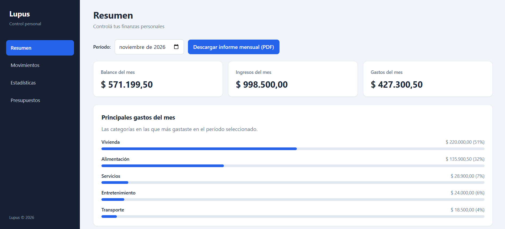
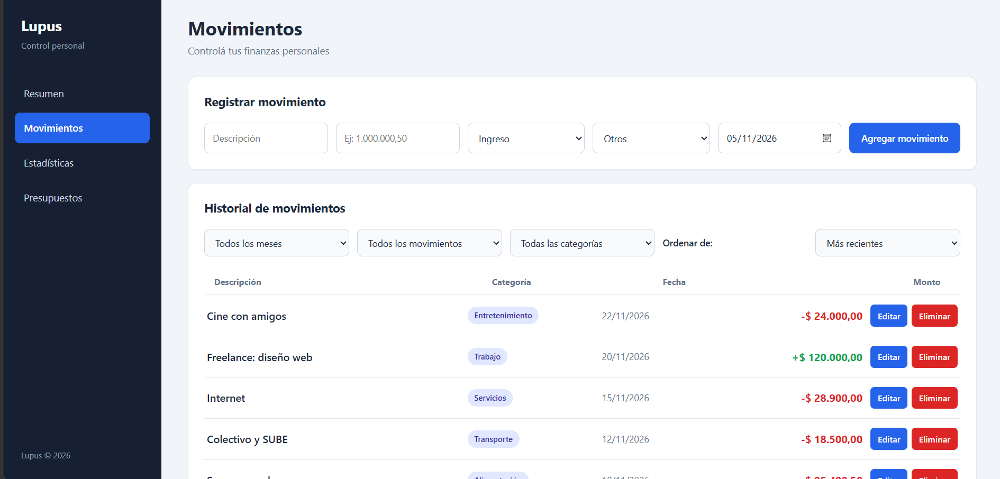
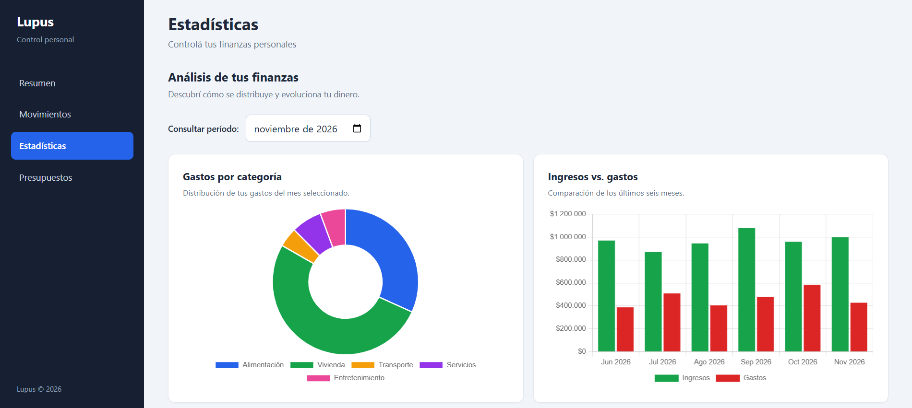
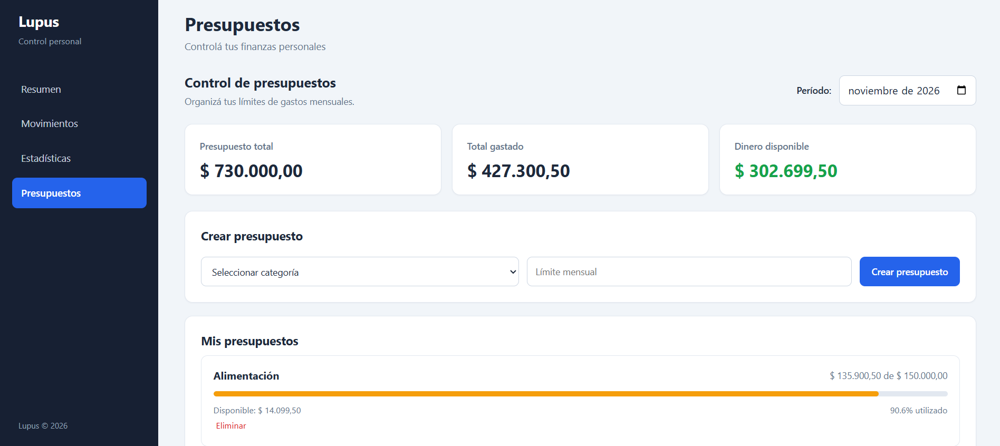

# Lupus – Gestor de Gastos

Aplicación web para registrar ingresos y gastos, organizar movimientos y controlar el presupuesto mensual. Funciona en el navegador, no requiere cuenta y se puede instalar como aplicación.

**Demo:** https://gabriel-trevisan12.github.io/lupus-gestor-de-gastos/

## Capturas

| Resumen | Movimientos |
|---|---|
|  |  |

| Estadísticas | Presupuestos |
|---|---|
|  |  |

## Funcionalidades

- **Resumen mensual** con balance, ingresos, gastos y las categorías en las que más gastaste.
- **Movimientos**: registrar, editar y eliminar ingresos y gastos, con categoría y fecha.
- **Filtros y orden** por mes, tipo y categoría, y ordenamiento por fecha o importe.
- **Estadísticas** con gráficos de gastos por categoría e ingresos vs. gastos de los últimos seis meses.
- **Presupuestos** por categoría, con barra de progreso y alertas cuando te acercás al límite o lo superás.
- **Informe mensual** descargable en PDF.
- **Datos de ejemplo** para probar la app con un clic.
- **Uso sin conexión** gracias al Service Worker.

## Tecnologías

- HTML5, CSS3 y JavaScript (sin frameworks)
- Chart.js para los gráficos
- LocalStorage para guardar los datos
- Service Worker y Web App Manifest para la versión instalable

## Cómo ejecutarlo

1. Cloná el repositorio:
   ```bash
   git clone https://github.com/Gabriel-Trevisan12/lupus-gestor-de-gastos.git
   ```
2. Abrí la carpeta en VS Code y usá **Live Server** (botón *Go Live*).

   O bien, desde la carpeta del proyecto:
   ```bash
   python3 -m http.server 8000
   ```
   y entrá a `http://localhost:8000`.

> El botón de datos de ejemplo lee `data/ejemplo.json`, por eso necesita un servidor. Si abrís `index.html` directamente con doble clic, no va a cargar.

## Decisiones técnicas

- **Sin cuenta ni backend.** Los datos se guardan en LocalStorage del navegador. Así no hay que administrar servidores ni bases de datos. El límite es que los datos no se sincronizan entre dispositivos ni navegadores.
- **PWA.** El manifest y el Service Worker permiten instalarla y usarla sin conexión.
- **Datos de ejemplo en JSON.** `data/ejemplo.json` se carga con `fetch`. Antes de reemplazar lo guardado, la app pide confirmación.
- **Sin frameworks.** Está hecha a mano para practicar manipulación del DOM, manejo de estado y persistencia.

## Estructura

```
├── index.html
├── css/styles.css
├── js/app.js
├── data/ejemplo.json
├── libs/chart.umd.min.js
├── service-worker.js
├── manifest.json
├── icons/
└── docs/img/
```


## Autor

Gabriel Trevisan – Técnico Superior en Programación